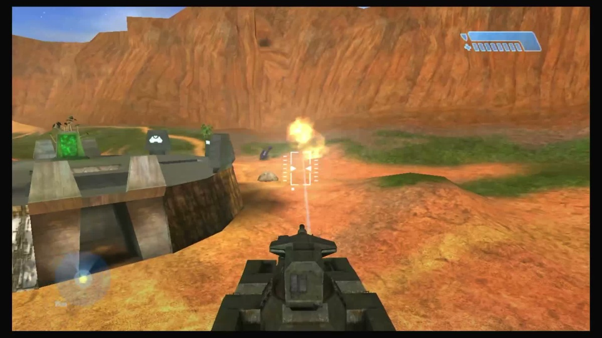

<p align="center"></p>

<h1 align="center">Warthog for Wii U</h1>

<p align="center"><b>Chupathingy on the Wii U.</b></p>

<p align="center">
<a href="https://github.com/ChupathingyCE/warthog-wiiu/releases">Download the test build</a> ·
<a href="https://stats.chupathingy.org">Games online now</a> ·
<a href="https://github.com/ChupathingyCE/chupathingyce">The game</a> ·
<a href="https://discord.gg/chupathingy">Discord</a>
</p>

<p align="center"></p>

Play Chupathingy as homebrew on a Wii U with Aroma. Play on the TV with the
GamePad or a Pro Controller, and join the same online games as PCs and other
consoles.

**Status: public test builds.** Earlier test builds play the menus,
multiplayer maps and online games on real consoles. The newest one, on the
0.9.0 game, has so far run in the Cemu emulator only. The campaign hasn't
been tested yet.

Get the newest test build from [Releases](https://github.com/ChupathingyCE/warthog-wiiu/releases).

You need your own copy of Halo. No game files are included.

## What you need

- **A Wii U running [Aroma](https://aroma.foryour.cafe/)**, and its SD
  card.
- **Your own Halo maps:** the North American (NTSC) maps, 01.10.12.2276,
  from your own copy of Halo. The build has no game files, and we never
  share them.

## Install

1. Download the newest `chupathingy-wiiu-test-<date>.zip` from
   [Releases](https://github.com/ChupathingyCE/warthog-wiiu/releases), unpack it,
   and copy its `wiiu` folder to the root of your SD card, so you end up with
   `wiiu/apps/halo.wuhb` and `wiiu/apps/halo/halo.rpx`.
2. Copy your maps into `wiiu/apps/halo/maps` on the SD card.
3. Start Chupathingy from the Wii U Menu.

To update, copy the new `wiiu` folder over the old one. Your maps and
settings stay.

## What works

- The menus, and the multiplayer maps offline.
- **Online Games:** the [C] Warthog servers and community servers. It joins
  OpenCE's newest servers (network version 41) and older ones.
- **Up to 32 players.** Online Games lists only the servers that fit.
- **Controllers:** the GamePad and the Pro Controller. A accepts, B goes
  back.
- **Split screen:** when you join a game in progress, the host waits a few
  seconds for the other players on your Wii U. Press A on their
  controllers right away.
- **Sound**, and HOME and Close from the HOME Menu.
- **The Halo CE+ map pack:** copy its maps to `wiiu/apps/halo/maps_cex` to
  join CE+ games.
- **Link your Delta profile** (below).

## Link your Delta profile

On Online Games, press + (Start) to open DELTA PROFILE, then A for a code.
Enter it at stats.chupathingy.org/connect, signed in on your phone or
computer (or scan the QR code), then press A on the Wii U to confirm. Your
games then count toward your profile. The Wii U makes its own key for this
(`wiiu/apps/halo/delta_device.key` on the SD card); nothing secret is sent.
Keep that file to yourself. Unlink on the site's profile page.

## Known issues

- Online matches ran at about 15 fps (frame pacing) in earlier builds;
  this is being worked on.
- The campaign has not been tested yet.
- No movies: they are skipped.
- A game that grows past 32 players is left, as a full one is.
- The picture is slightly inset from the edges of the TV.
- On some capture cards the TV picture may not fit until you press HOME once;
  regular TVs are fine.

## Reporting problems

1. Copy `wiiu/apps/halo/logs/debug.txt` and `wiiu/apps/halo/port.txt` from
   the SD card to your computer.
2. Send them at [dump.chupathingy.org](https://dump.chupathingy.org), with
   "Wii U" as the platform. You get a reference code.
3. Tell us in #wii-u on the [Discord](https://discord.gg/chupathingy) what
   you were doing, and give the code.

## What is here

- `chupathingyce/`: the game, a submodule of
  [ChupathingyCE/chupathingyce](https://github.com/ChupathingyCE/chupathingyce).
- `port/wiiu/`: the Wii U port: `build.py` (the build rules), `include/` (the
  prefix header), `src/` (the console layer), and a README with its requirements.
- `tools/wiiu_package.py`: lays out the build for an SD card (Aroma, at
  `sd:/wiiu/apps/halo/`) or for Cemu.
- `tools/cemu_smoke.sh`: a smoke test in Cemu 2.6 or later. It boots the
  package to the main menu, then into Blood Gulch for 60 seconds, with your
  own maps linked, never copied. It fails on a halt, a shader that did not
  compile, or no frames drawn, and on Linux takes a screenshot every 15
  seconds (its own Xvfb when there's no display; `--renderer opengl` for
  Cemu's OpenGL). A pass in Cemu is not a pass on a Wii U.

The Wii U is big-endian, like the Xbox 360.

## Building

Clone with the submodule:

```sh
git clone --recursive https://github.com/ChupathingyCE/warthog-wiiu.git
cd warthog-wiiu
```

You need devkitPro's devkitPPC and wut (`/opt/devkitpro`, or pass
`--devkitppc DIR` and `--wut DIR`). CI builds with wut 1.9.2; 1.9.1 works
too. Then:

```sh
python3 chupathingyce/configure.py --console-port port/wiiu --console-no-debug-asserts --console-players 32
ninja wiiu
```

`--console-no-debug-asserts` is the build testers get, faster on the
console: the debug decomp's asserts are compiled out, as the retail game had
them, except the memory checks. Leave it out for a build that stops at the
first failed assert. `--console-players 32` is the 32-player build testers
get, as on the original Xbox; without it the game's configure builds 16.

This is the game's console-port build; see "Console ports" in the game's
[docs/building.md](https://github.com/ChupathingyCE/chupathingyce/blob/main/docs/building.md).
If the toolchain is missing, configure says so and stops.

The shader compiler, [CafeGLSL](https://github.com/Exzap/CafeGLSL) (MIT, v1.0.0-rc1
or later), is linked statically: unpack the release's `wiiu-ppc` archive and
pass `--cafeglsl DIR`, or put it in `/opt/devkitpro/portlibs/wiiu`.

## CI and test builds

`.github/workflows/build.yml` builds in devkitPro's `devkitpro/devkitppc` image
for every pull request, every push to main and by hand, and keeps the SD card's
folder (`wiiu/apps/halo.wuhb`, `wiiu/apps/halo/halo.rpx`) as the run's
artifact. It downloads CafeGLSL from its release and checks the archive's
SHA-256; nothing else needs setting up, and no maps are ever packaged.

To put up a test build, push a tag on the commit to build:
`git tag test-20261022 && git push origin test-20261022` (or `v<number>`).
`release.yml` builds it and publishes a pre-release, "Wii U test build", with
the zip of the card's folder, its SHA-256, and the notes in
`.github/release-notes.md` (edit that file to change what they say).

## Your own Halo files

Bring your own Halo files. This repository never contains, and we never
share, the game's maps or other data. Packaging copies the maps from a
folder you point it at, onto your own SD card.

## Links

- The game: https://github.com/ChupathingyCE/chupathingyce
- Games online now: https://stats.chupathingy.org
- Discord: https://discord.gg/chupathingy

Licensed GPL-3.0; see `LICENSE`.

Warthog is an unofficial fan project. It isn't affiliated with or endorsed by
Nintendo, Microsoft, Xbox Game Studios, Bungie or Halo Studios. Halo is a
trademark of Microsoft. No game files are included: you bring your own copy.
